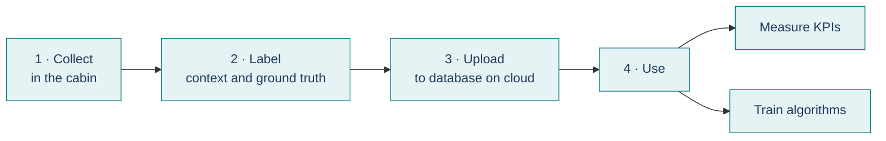

# A Ground Truth System's Data Workflow Overview

[GTS_Dataflow.pptx](GTS_Dataflow.pptx) is a short, non-technical introduction of the life of vehicle in-cabin data in a Ground Truth System: how the data is collected, labelled, uploaded to the cloud, and then used to measure KPIs and to train algorithms. It explains what happens to the data at each stage and why, without implementation details.

| | |
| **Length** | 6 slides, about 5 minutes |
| **Audience** | Anyone who needs a big picture; no technical background needed |
| **Format** | PowerPoint slides |

## The four stages

The talk follows the data through four stages, one slide each.

- **Collect.** Multiple cameras and sensors observe the driver, from reference cameras, motion capture cameras, and 3D tracking systems to vital signs. All sources are brought onto one format and one clock, and each session is saved as one complete recording.
- **Label.** Each recording gets labels for its context, such as the scenario, the environmental conditions, and the people on board. It also gets ground truth for every frame: where the driver sits and looks, the position and rotation of the head, how open the eyes are and the vital signs of the driver.
- **Upload.** Each recording is bundled with its labels into one archive and uploaded to the cloud recording database, where it is stored together with its labels.
- **Use.** KPI tool measures how well the device under test performs against the ground truth. The same labelled recordings also serve as training and test data for new algorithms.

## In short

Collect, label, upload, use: the system turns what happens in the cabin into labelled data in the cloud. That data measures how well today's in-cabin sensing system performs and trains tomorrow's algorithms. The [slides](GTS2_dataflow.pptx) walk through each stage in turn.
